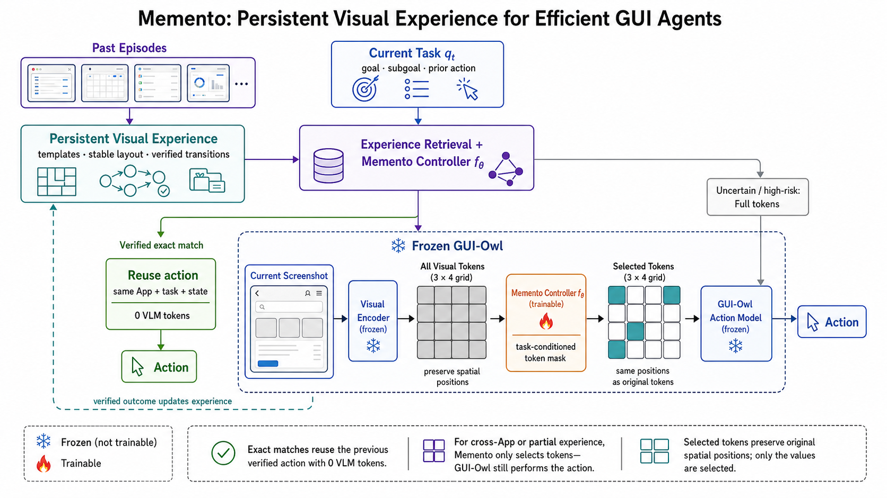

# PAVE: Persistent Across-Episode Visual Experience for Token-Efficient GUI Agents

> PAVE is a lightweight history-guided token-routing framework for frozen GUI
> agents. The Python package retains the historical `memento` name for
> compatibility with existing experiment artifacts.

PAVE is a research prototype for screenshot-based GUI agents. It uses
**cross-episode visual experience to decide which visual tokens of the current
screen must be retained**, while keeping the GUI action backbone frozen.

The central premise is simple: repeated use of an application produces stable
page templates and successful visual experience. Rather than appending this
experience as more language or image context, Memento turns it into a small,
position-aligned prior for a lightweight token controller. The controller then
selects tokens at their original GUI locations before the frozen action model
predicts the next action.

> **Status.** Research code accompanying an in-progress paper. The public
> repository contains the core controller, retrieval prior, training code, and
> GUI-Owl integration utilities. It intentionally excludes datasets,
> checkpoints, experiment outputs, and cluster-specific job scripts.

## Why Memento?

Existing GUI-agent memory methods commonly add historical text, screenshots, or
ROI crops to an action model's context. Visual-token pruning methods usually
use only the current screen or a short local trajectory. Memento asks a
different question:

> Can verified experience from past episodes allocate the *current* screen's
> visual-token budget more effectively?

PAVE therefore:

- keeps the action backbone (currently GUI-Owl) frozen;
- retrieves similar past page experiences with fixed CLIP screen/task/OCR
  embeddings;
- projects only verified sparse historical masks to a normalized lattice of the
  current screen;
- predicts a token-wise keep mask for **current** post-encoder tokens;
- preserves the original 2-D token locations—no screenshot crop and no ROI
  stitching;
- uses a conservative similarity route: high-risk states may be handed to a
  user, low-similarity states use the Full action model, and similar states use
  the Compact route.

## Method overview



```text
Past verified experiences                 Current screenshot + task
          |                                           |
          +---- frozen Top-3 retrieval ---------------+
                               |
                 position-aligned spatial prior
                               |
current GUI-Owl post-encoder tokens + task + prior
                               |
                Memento-Dynamic controller
             coarse context -> fine keep logits
                               |
             selected current tokens (same xy)
                               |
                  frozen GUI-Owl action model
                               |
                            next action
```

The controller has a coarse-to-fine, DynamicViT-inspired structure. The coarse
stage predicts a high-recall context signal; the fine stage predicts one keep
logit per current token. The historical prior has three channels per current
token: weighted historical support, cross-history disagreement, and the
fraction of retrieved records with verified sparse support.

## Token accounting

All reported Memento token costs refer to **post-encoder visual tokens passed
to the frozen GUI-Owl action model**. They are not black-box API billing, nor
the raw pre-merge patch count, nor total vision-encoder FLOPs.

GUI-Owl uses a 2x2 visual-token merge. For raw visual grid `[1, H, W]`, the
post-encoder action-model lattice is `[H/2, W/2]`. Memento masks this latter
lattice. During compact inference, visual features, M-RoPE positions,
deepstack features, and image placeholders are all selected using the same
original token indices; this is necessary to preserve grounding alignment.

## Repository layout

```text
memento/
  models/             # dynamic coarse-to-fine token controller
  retrieval.py        # frozen retrieval score and spatial-prior construction
  guiowl.py           # optional position-aligned GUI-Owl injection adapter
  qwen.py             # optional position-aligned Qwen2.5-VL injection adapter
  online.py           # success-conditioned, episode-atomic experience bank
  routing.py          # confidence gate and position-safe token selection
  data.py              # cached-feature dataset
  losses.py            # sparse-mask loss
scripts/
  train_dynamic.py     # history-aware / current-only training
configs/               # default model/training configuration
examples/              # index and cached-feature schema
tests/                 # alignment and model-shape smoke tests
integrations/          # benchmark integration contracts
```

`scripts/audit_online_bank.py` validates record/label/embedding alignment and
reports record kinds, per-package coverage, and SHA-256 hashes for a frozen
online bank. It reads metadata only and does not load either action backbone.

## Installation

```bash
git clone https://github.com/aidenyangaoxiang/Memento.git
cd Memento
python -m venv .venv
source .venv/bin/activate
pip install -U pip
pip install -e .
pytest -q
```

For GUI-Owl inference, install a CUDA-compatible PyTorch build and the
dependencies required by your GUI-Owl checkout. The adapter assumes the
`mPLUG/GUI-Owl-1.5-8B-Instruct` interface used in the accompanying
experiments; model weights are obtained separately from their official source.

## Data contract

The released code operates on cached frozen features. Each feature record
(saved with `torch.save`) contains:

| Field | Shape | Meaning |
| --- | --- | --- |
| `current_tokens` | `[N, D_visual]` | current GUI-Owl post-encoder visual tokens |
| `xy` | `[N, 2]` | normalized centers in the original current-token lattice |
| `task_embedding` | `[D_task]` | frozen task representation |
| `target_mask` | `[N]` | offline sufficient-mask supervision |
| `experience_id` | string | unique state identifier |

Each spatial-prior record contains `spatial_prior: [N, 3]`, constructed from
the query's fixed Top-3 retrieved historical experiences. An example index is
in [`examples/feature_index.example.json`](examples/feature_index.example.json).

### Building supervision

The supplied model is trained on offline sufficient-mask labels. A practical
data-generation procedure is:

1. Run the frozen action backbone on the full screenshot.
2. Keep only states with a valid, externally checkable action outcome (e.g., a
   click landing inside a ground-truth bounding box).
3. Search a small family of context-preserving masks—target neighborhood,
   task-matched OCR, layout bands, and retrieved-history support.
4. Re-run the frozen action model with each candidate mask.
5. Select the smallest candidate that preserves the externally verified
   outcome. If no candidate succeeds, label it **unresolved by the candidate
   search**, not intrinsically impossible to compact.

The current code deliberately treats full-only labels with care: they are not
converted into all-one spatial priors.

## Training

```bash
# Memento-Dynamic: uses history priors
python scripts/train_dynamic.py \
  --train-index /path/to/train_index.json \
  --val-index /path/to/val_index.json \
  --out outputs/history_aware

# Matched current-only ablation: same architecture, zero history prior
python scripts/train_dynamic.py \
  --train-index /path/to/train_index.json \
  --val-index /path/to/val_index.json \
  --out outputs/current_only \
  --current-only
```

For fair ablations, hold the controller architecture, mask budget, frozen
backbone, data split, and action evaluator fixed. Change only whether the
spatial prior is present.

## Online experience lifecycle

`EpisodeAtomicBank` stages records during a rollout and commits them only when
an external task evaluator reports success. Full-route successes add retrievable
templates without fabricating sparse masks. Compact-route successes add spatial
evidence only when their realized retained ratio passes the configured sparsity
admission rule. Read-only mode supports frozen-bank revisit experiments.

AndroidWorld-specific integration requirements are documented in
[`integrations/androidworld/README.md`](integrations/androidworld/README.md).

## Backbone adapters

The GUI-Owl and Qwen2.5-VL adapters prune post-encoder/post-merger visual
tokens. In both cases, selected original indices are sorted before injection
and applied consistently to visual features, image placeholders, and positional
IDs. This preserves token-to-position correspondence.

## Reproducibility and safety notes

- No training data, GUIOdyssey assets, GUI-Owl weights, OCR caches, or
  checkpoints are included here. Obtain and use each resource under its own
  license/terms.
- The public code contains no user credentials, API keys, local absolute paths,
  experiment logs, or Slurm scripts.
- A `Full` fallback and human handoff rules are policy components; offline
  bbox evaluation cannot establish their online safety.
- Online bank writes require an external task-success signal. The package does
  not infer success from the model's own action text.

## Citation

If you use this code, please cite the paper once available:

```bibtex
@misc{yang2026memento,
  title={PAVE: Persistent Across-Episode Visual Experience for Token-Efficient GUI Agents},
  author={Yang, Aiden and collaborators},
  year={2026},
  note={Work in progress}
}
```

## Acknowledgments

This repository integrates with GUI-Owl but is not affiliated with the GUI-Owl
authors. Please cite GUI-Owl and any dataset used in your experiments.
