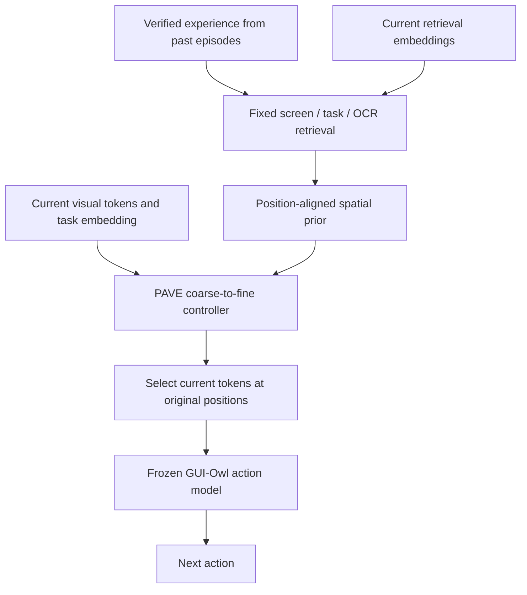

# PAVE

**Experience-guided visual token selection for frozen GUI agents.**

Research code for **[Don't Look Twice: Leveraging Visual Experience for Token-Efficient GUI Agents](https://openreview.net/forum?id=SXHU6x7cQl)**<br>
**Aoxiang Yang and Sidong Feng** · Manuscript under review at **ICLR 2027**

[Quick start](#quick-start) · [Method](#how-it-works) · [Training](#training) · [Reproducibility](docs/reproducibility.md) · [Citation](#citation)

PAVE reuses verified experience from previous GUI tasks to decide which visual
tokens of the **current screen** to retain. A lightweight controller combines
current visual features, the task, and a spatial prior retrieved from past
episodes. The GUI action model stays frozen, and retained tokens keep their
original spatial positions.

The repository includes the controller, retrieval and routing utilities,
training scripts, backbone adapters, and tests. Datasets and trained
checkpoints are obtained separately; see [release contents](#release-contents).

## Quick start

Use **Python 3.10 or newer**. From a fresh checkout:

```bash
git clone https://github.com/aidenyangaoxiang/PAVE.git
cd PAVE
python -m venv .venv
source .venv/bin/activate
python -m pip install --upgrade pip
python -m pip install -e ".[dev]"

# Run a small CPU example: no pretrained weights, dataset, or GPU required.
python examples/controller_demo.py

# Check controller shapes, spatial alignment, routing, and bank behavior.
python -m pytest -q
```

The example constructs a synthetic spatial prior, runs an **untrained**
controller on 32 visual tokens, and retains 8 tokens in their original order.
It demonstrates the API and tensor flow; its output is not a benchmark result.

| Goal | Entry point | Required resources |
| --- | --- | --- |
| Inspect the controller and token selection | [CPU example](examples/controller_demo.py) | Installed package only |
| Train the controller or a current-only ablation | [Training script](scripts/train_dynamic.py) | Cached features, labels, and spatial priors |
| Generate offline sufficient-mask supervision | [Supervision script](scripts/generate_guiodyssey_supervision.py) | GUI-Owl weights, screenshots, history bank, embeddings, labels, and action prompt |
| Connect online evaluation | [AndroidWorld integration contract](integrations/androidworld/README.md) | External benchmark runner and evaluator |
| Inspect a saved experience bank | [Bank audit](scripts/audit_online_bank.py) | Bank metadata and embeddings |

## How it works



1. **Retrieve experience.** Fixed screen, task, and OCR embedding similarities
   select relevant historical records. The default configuration uses Top-3
   retrieval with weights `0.5 / 0.3 / 0.2`.
2. **Build a spatial prior.** Verified sparse historical masks are projected
   onto the current token lattice. The three channels encode weighted support,
   disagreement, and sparse-support fraction.
3. **Select current tokens.** A DynamicViT-inspired coarse-to-fine controller
   predicts one keep logit per current token. Budgeted selection returns the
   selected original indices in spatial sequence order.
4. **Act with a frozen backbone.** Adapters apply the same indices to visual
   features and their associated positional information. Historical tokens are
   not appended to the action model's context.

The public similarity router uses the Full route when scoped history is
missing, similarity is below threshold, or a surface is marked protected.
Online experience is committed only after an external evaluator reports
episode success.

### Token accounting

The token budget refers to **post-encoder visual tokens passed to the action
model**. It does not measure API billing or total vision-encoder computation.
For GUI-Owl's `2x2` token merge, a raw grid `[1, H, W]` becomes an action-model
lattice `[H/2, W/2]`. Compact inference must preserve the correspondence
between selected features, image placeholders, M-RoPE positions, and
deepstack features.

## Repository layout

```text
memento/                     # Historical Python import name; method name: PAVE
  models/                    # Coarse-to-fine token controller
  retrieval.py               # Retrieval scores and spatial priors
  routing.py                 # Similarity gate and position-safe token selection
  guiowl.py                  # GUI-Owl post-encoder adapter
  qwen.py                    # Qwen2.5-VL post-merger adapter
  online.py                  # Success-conditioned, episode-atomic experience bank
  supervision.py             # Offline candidate-mask construction
  data.py                    # Cached-feature dataset and collation
  losses.py                  # Sparse-mask training losses
scripts/                     # Training, supervision generation, and bank audit
examples/                    # Runnable CPU demo and feature/index schemas
configs/                     # Reference controller/training/retrieval settings
integrations/androidworld/   # Contract for an external benchmark runner
tests/                       # Controller, alignment, routing, and bank checks
docs/                        # Data preparation and reproduction details
```

The distribution name remains `memento-gui`, and imports use `memento` and
`MementoDynamicController`. These historical names are retained for
compatibility with existing experiments and checkpoints.

## Training

Prepare the cached tensors and index files described in the
[data contract](docs/reproducibility.md#cached-feature-data-contract). Index
paths are resolved relative to the process's working directory; run the
following commands from the repository root or use absolute paths.

```bash
# History-aware PAVE controller
python scripts/train_dynamic.py \
  --train-index /path/to/train_index.json \
  --val-index /path/to/val_index.json \
  --out outputs/history_aware

# Matched current-only ablation: same controller, zero history prior
python scripts/train_dynamic.py \
  --train-index /path/to/train_index.json \
  --val-index /path/to/val_index.json \
  --out outputs/current_only \
  --current-only
```

Training saves best-loss and best-F1 controller checkpoints, epoch metrics,
and a summary in the output directory. The script refuses to overwrite a
non-empty output directory. Run `python scripts/train_dynamic.py --help` for
supported options; `configs/dynamic_controller.yaml` is a reference, not a
configuration file automatically loaded by this script.

For matched ablations, keep the architecture, token budget, backbone, data
split, and action evaluator fixed. Change only the presence of the historical
spatial prior.

## Release contents

| Component | Availability |
| --- | --- |
| Controller, retrieval, routing, and online bank | Included |
| Training and offline supervision scripts | Included |
| GUI-Owl and Qwen2.5-VL adapter utilities | Included |
| CPU demo and tests | Included |
| Training data, screenshots, OCR caches, and frozen feature banks | Not bundled |
| Backbone weights and trained PAVE checkpoints | Not bundled |
| Complete AndroidWorld runner and experiment outputs | Not bundled; integration contract provided |

For GUI-Owl inference, use a CUDA-compatible PyTorch build and dependencies
compatible with `mPLUG/GUI-Owl-1.5-8B-Instruct`. Obtain backbone weights and
datasets from their original providers under their respective terms. The CPU
demo and unit tests do not reproduce the paper's end-to-end benchmark results.

See [reproducibility details](docs/reproducibility.md) for supervision
generation, online-bank handling, and external integration requirements.

## Citation

The accompanying manuscript is under review. Please preserve that status
when citing it:

```bibtex
@misc{yang2026dontlooktwice,
  title = {Don't Look Twice: Leveraging Visual Experience for Token-Efficient GUI Agents},
  author = {Yang, Aoxiang and Feng, Sidong},
  year = {2026},
  howpublished = {\url{https://openreview.net/forum?id=SXHU6x7cQl}},
  note = {Manuscript under review at ICLR 2027}
}
```

Machine-readable citation metadata is available in [CITATION.cff](CITATION.cff).

## License and acknowledgments

The code is released under the [MIT License](LICENSE). External models,
datasets, and dependencies retain their own licenses. PAVE integrates with
GUI-Owl; please also cite the backbone and datasets used in your experiments.
